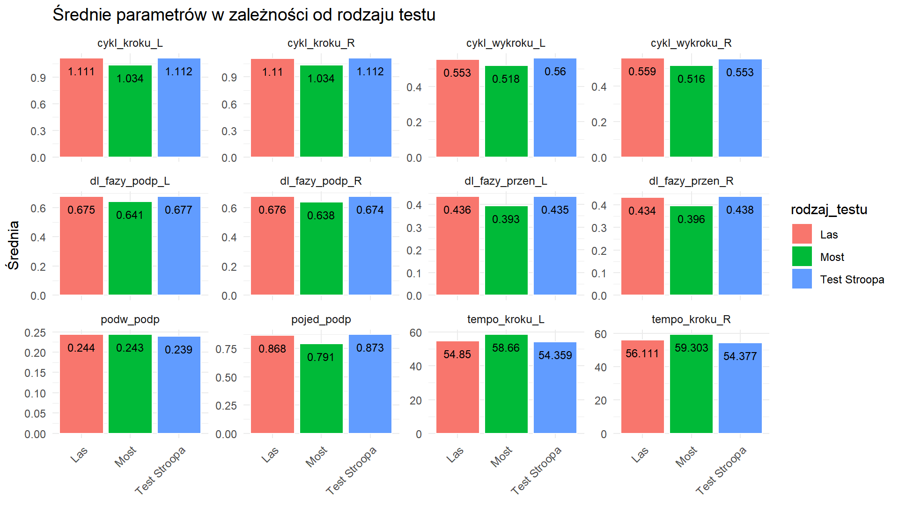
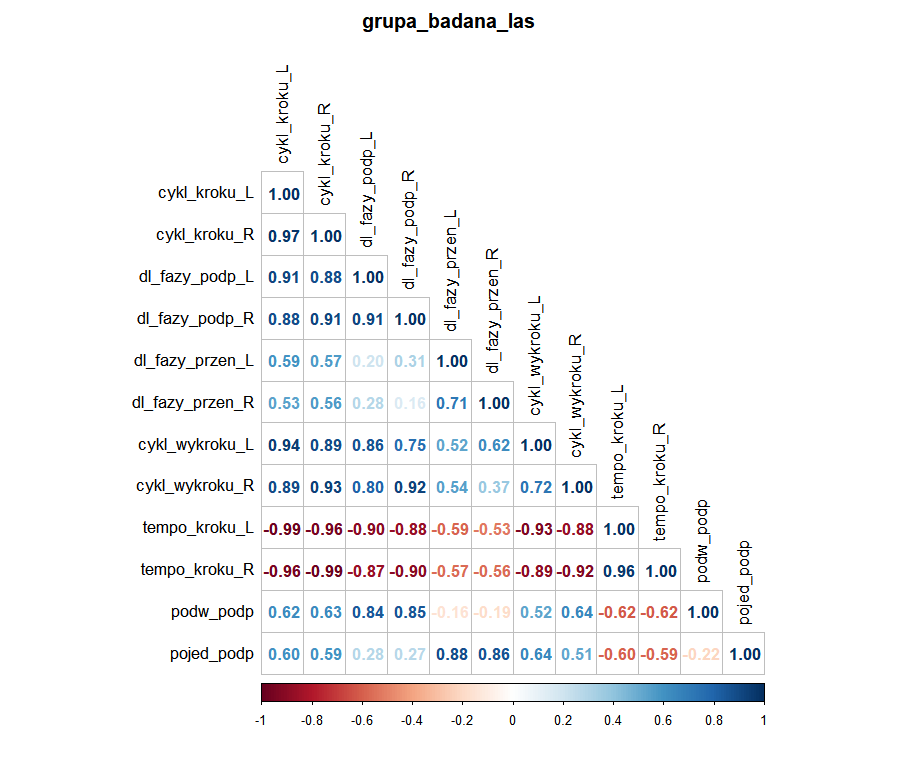

# Walk Cycle EDA

**Does cognitive load erase gait differences between autistic and neurotypical walkers?** A statistical analysis of motion-capture data from a CAREN Extended rehabilitation treadmill, done as the final project for the *Statistical Methods* course at the Silesian University of Technology.


## The data

About **8,600 gait cycles**: roughly 4,650 from the study group (autism spectrum) and 4,000 from the control group. They were recorded with motion capture while participants walked through three virtual scenarios:

| Scenario | What it adds |
|---|---|
| 🌲 **Forest** (*Las*) | a baseline walk through a virtual forest |
| 🌉 **Rope bridge** (*Most*) | balance and visual challenge |
| 🎨 **Stroop test** | cognitive load while walking (name the ink colour, not the word) |

Each cycle carries 12 parameters for the left and right leg: step cycle, stance and swing phase, stride cycle, cadence [1/min], and single and double support time.

## Pipeline

```
raw CSV ─► clean (drop invalid ≤ 0 values, IQR outliers) ─► aggregate per group × scenario
        ─► normality: Shapiro–Wilk + Kolmogorov–Smirnov + QQ-plots (Bonferroni α = 0.05/12)
        ─► Mann–Whitney U (two-sided, then one-sided) ─► effect size: Cohen's d
        ─► within-group Pearson correlation matrices
```

The normality tests disagreed with each other and with the QQ-plots, so the parametric route, and with it Levene's test, was dropped in favour of a non-parametric comparison.

## Findings

- **Forest, Bridge and all scenarios combined:** the time-based gait parameters of the autism-spectrum group sit **significantly lower** than the control group's (one-sided Mann–Whitney U). Cohen's *d* confirms the effect.
- **Stroop test:** most differences **stop being significant**. Adding a cognitive task seems to make the two groups walk alike.
- **Correlations:** step cycle tracks stance phase and stride very closely. Cadence is strongly inversely correlated with every duration. In the control group, double-support time is much more loosely tied to the other parameters.

<p align="center">
  
  <br><sub>Mean parameters of the study group per scenario. On the bridge, steps and swing phases get shorter and cadence goes up.</sub>
</p>

<p align="center">
  
  <br><sub>Pearson correlations, study group, forest scenario.</sub>
</p>

## Repository layout

| Path | Contents |
|---|---|
| `R/data_visualization.R` | the whole analysis: cleaning, aggregation, tests, effect sizes and plots |
| `P03_A/` | input data (CSV / XLSX) and the assignment brief |
| `Wykresy/` | generated figures: box plots, histograms, QQ-plots, correlation matrices, bar charts |
| `Prezentacje/` | slides from both project milestones (in Polish) |

## Run it

1. Install the packages: `install.packages(c("tidyverse", "gridExtra", "corrplot"))`
2. Open `R/MS_projekt.Rproj` in RStudio.
3. Point `path_badani` and `path_kontrolna` at the CSVs in `P03_A/`, then run the script top to bottom.

Variable names and plot labels are in Polish (*badana* = study group, *kontrolna* = control group).

## Team

Igor Kotlarz · Yevheniia Muravska · Kamil Musioł · Karol Pethe · Łukasz Wolf. Computer Science, semester 4, Silesian University of Technology.
